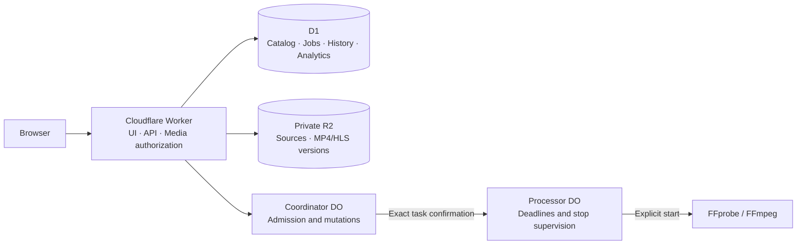

<h1 align="center">🎬 cf-video-studio</h1>

<p align="center">
  <strong>Your videos in your storage. Your screening room at the edge.</strong><br>
  Original playback first · Private R2 storage · Separate administration · Optional processing
</p>

<p align="center">
  <a href="https://developers.cloudflare.com/workers/"></a>
  <a href="https://www.typescriptlang.org/"></a>
  <a href="https://github.com/jacklilyhello/cf-video-studio/blob/main/LICENSE"></a>
</p>

<p align="center">
  <a href="README.md">简体中文</a> · <strong>English</strong><br>
  <a href="#screenshots">Screenshots</a> · <a href="#quick-start">Quick start</a> · <a href="docs/deployment.md#english">Deployment</a> · <a href="docs/user-guide.md#english">User guide</a> · <a href="https://github.com/jacklilyhello/cf-video-studio/actions?query=workflow%3AValidate">CI checks</a> · <a href="https://github.com/jacklilyhello/cf-video-studio/issues">Issues</a>
</p>

<p align="center">Requires Workers Paid · private R2 · D1 · Durable Objects<br>Processing defaults to disabled, with a quote and confirmation per task. <a href="docs/deployment.md#english">Full deployment requirements</a></p>


**cf-video-studio** manages and plays videos using React, TypeScript, Cloudflare Workers, D1, Durable Objects and private R2. Upload a source, inspect and preview a compatible MP4, then explicitly choose a version to publish. Separately confirmed lossless MP4 optimization, HLS remuxing and transcoding are available when needed. Administrators can configure the displayed site name and Logo; the public project name is cf-video-studio.

> [!IMPORTANT]
> The complete cloud deployment declares a Container image and requires **Workers Paid, enabled R2, your own resources and dedicated credentials**. Included usage and project capacity are not account free balances; this project does not guarantee free hosting. Processing defaults to disabled and every task still needs a quote and explicit confirmation. Read [billing and limits](docs/budget.md#english). Project-owned code and documentation use the [MIT License](LICENSE); third-party components retain their own licenses.

## Features

| | Current behavior |
| --- | --- |
| 🎞️ Originals first | Preview and publish compatible MP4 sources; bounded structure inspection, Range delivery and MSE for a supported fully indexed fMP4 subset |
| 📤 Multipart upload | 8 MiB parts, multiple-file queue, pause, resume and retry; 20 GiB per file plus project capacity and reservations |
| 🧩 Optional processing | Separately quoted copy-only MP4 faststart, compatible lossless HLS remuxing and explicitly confirmed single-quality transcoding |
| 🗂️ Versions and publishing | Sources and generated outputs remain separate; generated outputs remain unpublished; preview them before explicitly selecting a version to publish |
| 🔐 Separate access controls | Administrator password, optional visitor passphrase, signed host-only cookies and fresh authorization on media requests |
| 🕘 Viewing history | Continue, mark watched and clear history by host and browser cookie; no visitor registration |
| 📊 Two kinds of statistics | Automatic project resource usage and playback analytics, with source ranges, coverage gaps and estimate labels |
| 🧹 Storage management | Source, independent MP4, HLS and failed-output groups; exact deletion inventories, dependencies and resumable partial failures |
| 🎨 Appearance | Separate welcome page and room, light/dark/system themes, configurable name and PNG/JPEG Logo, optional search indexing |

Direct playback does not support every media format. It conservatively accepts supported H.264/AVC MP4 with optional AAC-LC stereo audio; fragmented MP4 has additional layout and index limits. Structural inspection, actual browser playback and a human audio/video check are separate evidence. Read [media scope and workflow](docs/user-guide.md#english).

## Screenshots

Captured on **2026-10-16 in real Safari**, showing webpage content only. These use the current application in an **isolated local demonstration environment**. Titles, usage and analytics are demonstration data, not real visitor records, cloud-processing acceptance or a production release. See [capture and material notes](docs/screenshots/README.md).

### Dark screening room


<details>
<summary><strong>Administration: overview, library, storage and automatic resource usage</strong></summary>

Overview combines catalog, storage and task status.


The library brings upload, source preview, playback versions and publication together.


Storage groups originals, generated versions and occupancy by video; deletion requires a separate inventory review.


Resource usage distinguishes official observations, project records and estimates; unknown values remain unknown.


</details>

## Architecture



Each environment owns a Worker, D1 database, private R2 bucket and DO namespaces. Workers Static Assets serve the frontend and the Worker authorizes media. No VPS, persistent Node server or separate Pages project is needed. Containers receive only task-scoped internal access, without account, deployment, administrator or R2 credentials. See [architecture and security boundaries](docs/architecture.md#english).

## Quick start

Use **Node.js 22.23.1 or a newer supported version and npm**. These commands do not deploy cloud resources:

```sh
git clone https://github.com/jacklilyhello/cf-video-studio.git
cd cf-video-studio
npm ci
npm run check
cp .env.example .dev.vars.test
```

In the ignored `.dev.vars.test`, choose a local-only administrator password and a random session secret of at least 32 characters; use your own configuration for other fields. Then run:

```sh
npm run build
npx wrangler d1 migrations apply DB --env test --local
npm run dev:worker
```

Open Wrangler's printed local URL. `dev:worker` explicitly disables Containers; unavailable Cloudflare analytics remain unknown. In another terminal, `npm run dev` starts Vite and proxies `/api` and `/media` to `127.0.0.1:8787` for frontend work. Complete browser checks involving `Secure` cookies need a trusted HTTPS local origin or isolated cloud origin.

**Deploy your own instance** using the [complete guide](docs/deployment.md#english): prepare your account, private storage, runtime Secrets and Cloudflare Workers Builds. It does not depend on files from the author's computer or upstream resources. GitHub CI validates code; Workers Builds releases the application and image. Merge, build, deployment and real-business acceptance are verified separately.

The migration PR is for source review only. The CI link shows the actual workflow state, without claiming that migration is merged or deployed. Existing cloud instances and Builds repository connections remain in place; this repository does not automatically take them over. Legacy `cf-video-hub` Worker/database/bucket defaults and internal compatibility names preserve existing resource identities. New installations can configure their own names following the deployment guide.

## Daily workflow

1. Visit `/admin` and sign in with the administrator password; the public page has no administration link.
2. Upload using project capacity, file size and concurrent reservations. No account-wide allowance approval or manual usage transcription is required.
3. Prefer a compatible original, actually play and seek it, confirm its audio/video or lack of audio, then create a source playback version.
4. If necessary, review an optional processing scope, instance, deadline, output and quote; confirm the exact task. Preview and explicitly publish the checked result.
5. Visitors watch published versions at `/video`. Unpublishing blocks subsequent media requests; deletion requires a separate inventory review and physical removal is irreversible.

Read the [user guide](docs/user-guide.md#english) for access revocation, deletion dependencies, cookies and analytics definitions.

## Documentation

| Guide | Contents |
| --- | --- |
| [Deployment and maintenance](docs/deployment.md#english) | Independent instance, configuration roles, Builds, updates, rollback and backups |
| [Administration and viewing](docs/user-guide.md#english) | Uploads, media scope, optional processing, publication, authorization and deletion |
| [Billing and budget](docs/budget.md#english) | Plans, included usage, chargeable operations and processing admission |
| [Resource usage](docs/resource-usage.md#english) | Rolling 24 hours, billing period, cumulative totals, sources and gaps |
| [Architecture and data behavior](docs/architecture.md#english) | Boundaries, immutable objects, history, analytics and module map |
| [API reference](docs/api.md#english) | Public/admin endpoints, authorization, fields and errors |
| [Application dependencies](docs/dependencies.md) · [Container licenses](container/LICENSES.md) | Dependency, FFmpeg, image and material rights |

Guides provide Chinese/English navigation. Actual acceptance and release evidence belongs in Pull Requests; implemented behavior is not labeled as cloud-verified without evidence. Screenshots demonstrate the interface. Operators must verify complete installation, real Container/HLS processing, target browsers and physical mobile devices, and backup restoration in their own environment.

## Maintenance and licensing

Report reproduction steps, browser versions and redacted errors through [Issues](https://github.com/jacklilyhello/cf-video-studio/issues). Do not attach passwords, tokens, cookies, raw visitor records or private media. Use a branch and PR, run `npm run check` and retain CI. Review branches should not be configured to publish to a running environment.

**Project-owned code and documentation use the [MIT License](LICENSE)** with `Copyright (c) 2026 lily Sally`. Redistributions must retain the copyright and permission notices required by that license. Third-party software, media, brands and trademarks retain their respective rights; MIT does not replace dependency, FFmpeg or Container license requirements described in the linked records.
