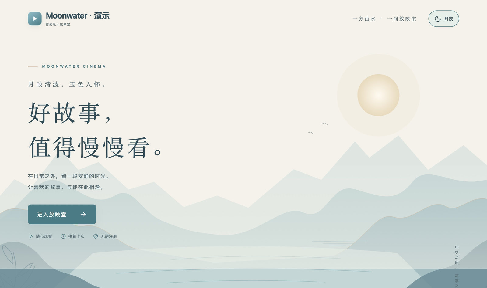
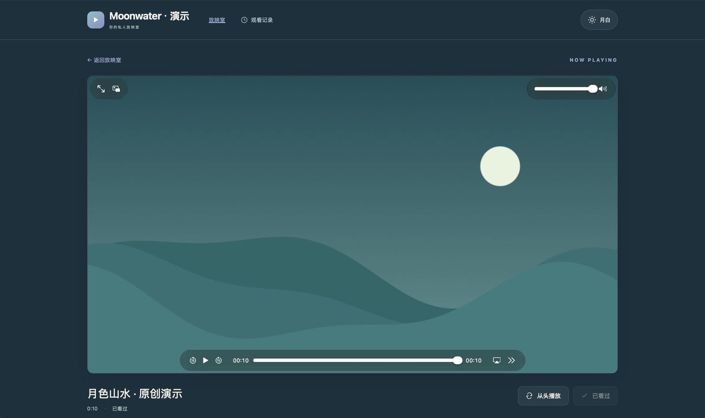
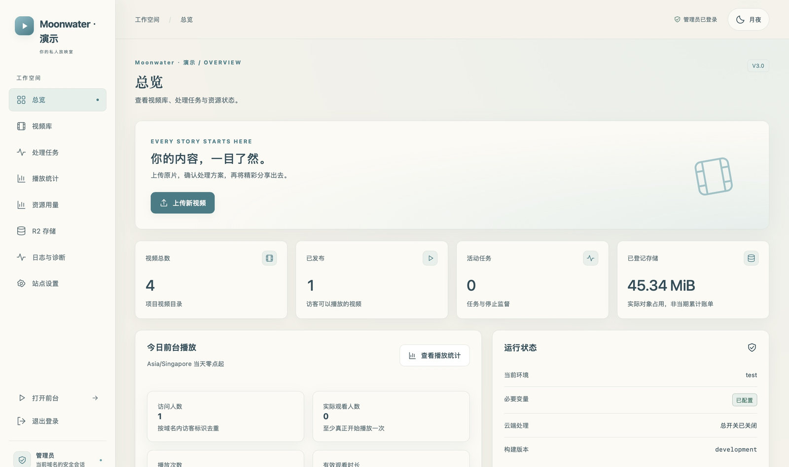
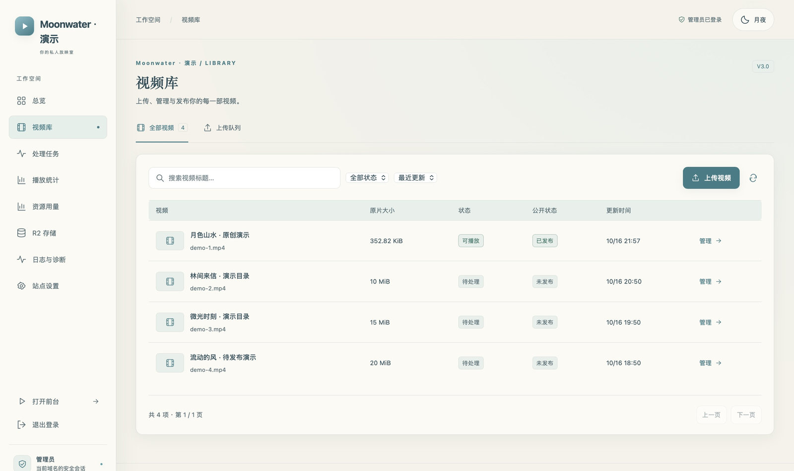
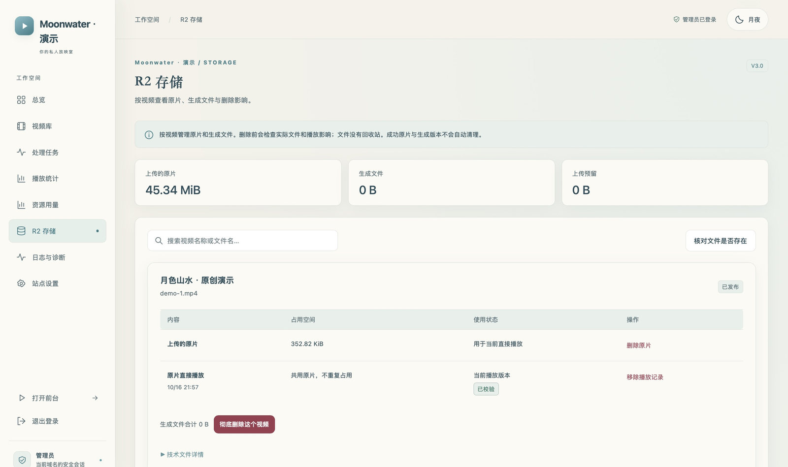
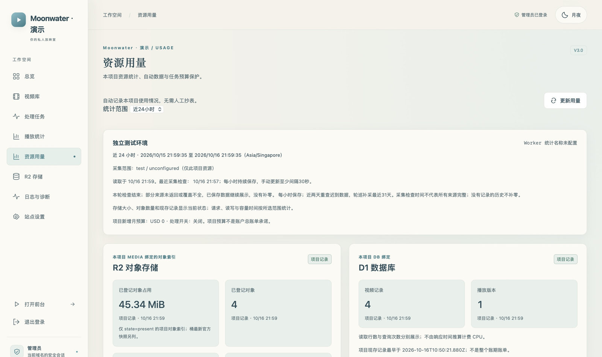
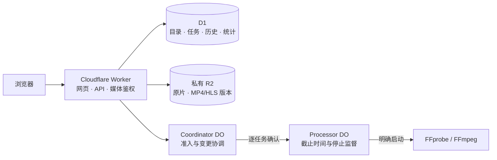

<h1 align="center">🎬 cf-video-studio</h1>

<p align="center">
  <strong>把视频留在自己的空间，把放映室放到 Cloudflare 边缘。</strong><br>
  原片优先播放 · 私有 R2 存储 · 独立管理后台 · 可选视频处理
</p>

<p align="center">
  <a href="https://developers.cloudflare.com/workers/"></a>
  <a href="https://www.typescriptlang.org/"></a>
  <a href="https://github.com/jacklilyhello/cf-video-studio/blob/main/LICENSE"></a>
</p>

<p align="center">
  <strong>简体中文</strong> · <a href="README.en.md">English</a><br>
  <a href="#界面预览">界面预览</a> · <a href="#快速开始">快速开始</a> · <a href="docs/deployment.md#中文">部署文档</a> · <a href="docs/user-guide.md#中文">使用手册</a> · <a href="https://github.com/jacklilyhello/cf-video-studio/actions?query=workflow%3AValidate">CI 检查</a> · <a href="https://github.com/jacklilyhello/cf-video-studio/issues">问题反馈</a>
</p>

<p align="center">部署前提：Workers Paid · 私有 R2 · D1 · Durable Objects<br>视频处理默认关闭，按任务报价与确认。<a href="docs/deployment.md#中文">查看完整部署要求</a></p>



**cf-video-studio** 是基于 React、TypeScript、Cloudflare Workers、D1、Durable Objects 与私有 R2 的视频管理和播放应用。上传原片，检查并预览兼容 MP4，再明确选择版本发布；需要时再单独确认无损整理、HLS 封装或转码。网站显示名称和 Logo 可在后台配置，公开项目名称为 cf-video-studio。

> [!IMPORTANT]
> 完整云端部署包含 Container 镜像，需要 **Workers Paid 套餐、已启用的 R2、自有资源及独立凭据**。包含额度和项目空间均不等于全账户免费余额；本项目不保证永久免费。处理默认关闭，开启总开关也不替代逐任务报价与确认。详见[费用与限制](docs/budget.md#中文)。项目自有代码与文档采用 [MIT 许可证](LICENSE)，第三方组件保留各自许可。

## 功能特性

| | 当前能力 |
| --- | --- |
| 🎞️ 原片优先 | 兼容 MP4 可直接预览、发布；支持有界结构检查、Range 与部分完整索引 fMP4 的 MSE 播放 |
| 📤 分片上传 | 8 MiB 分片、多文件队列、暂停、恢复、重试；单文件不超过 20 GiB，另受项目空间和预留约束 |
| 🧩 可选处理 | 独立报价的 MP4 faststart 无损整理、兼容 HLS 无损封装，以及明确确认的单档转码 |
| 🗂️ 版本与发布 | 原片与生成版本分开保存；生成物先保持未发布，预览后明确选择版本公开 |
| 🔐 独立访问控制 | 管理员密码、可选访客观看口令、签名且按域名隔离的 Cookie、每次媒体请求检查发布状态 |
| 🕘 观看记录 | 按当前域名和浏览器 Cookie 保存进度、继续观看、标记看过、清除历史；无需访客注册 |
| 📊 两类统计 | 自动项目资源用量与访客播放统计分开；保留来源、查询范围、缺口和估算标识 |
| 🧹 存储管理 | 原片、独立 MP4、HLS 与失败产物分组；精确删除清单、依赖检查与部分失败继续删除 |
| 🎨 站点外观 | 独立欢迎页、放映室、浅色/深色/跟随系统、可配置名称与 PNG/JPEG Logo、搜索收录开关 |

这不是任意格式都能直接播放的视频服务。原片路径保守支持 H.264/AVC MP4，可带受支持的 AAC-LC 双声道音轨；部分 fMP4 布局受额外索引限制。结构检查、真实浏览器实播、人工音画确认是三种不同证据。详见[媒体范围和工作流程](docs/user-guide.md#中文)。

## 界面预览

以下图片于 **2026-10-16** 在真实 **Safari** 中截取，仅包含网页内容。来源为当前代码的**本地隔离演示环境**；视频名称、用量和统计是演示数据，不代表真实访客记录、云端处理验收或生产发布。图片来源与素材说明见[截图说明](docs/screenshots/README.md)。

### 深色放映室



<details>
<summary><strong>管理后台：总览、视频库、存储与自动资源用量</strong></summary>

后台总览汇集目录、存储和任务状态。



视频库把上传、原片预览、播放版本和发布操作组织在同一工作区。



存储视图按视频列出原片、生成版本和空间占用，删除操作需单独审阅清单。



资源用量区分官方观测、项目记录和估算；无法确认的字段保留未知状态。



</details>

## 系统架构



一个环境对应一个 Worker、D1、私有 R2 桶及自己的 DO 命名空间。Workers Static Assets 提供前端，媒体始终通过 Worker 鉴权；不需要 VPS、常驻 Node 服务或独立 Pages 项目。Container 接收任务范围内的内部访问能力，不接收账户、部署、管理员或 R2 凭据。详见[架构与安全边界](docs/architecture.md#中文)。

## 快速开始

本地开发需要 **Node.js 22.23.1 或更新的受支持版本、npm**。以下命令不部署云端资源：

```sh
git clone https://github.com/jacklilyhello/cf-video-studio.git
cd cf-video-studio
npm ci
npm run check
cp .env.example .dev.vars.test
```

在忽略的 `.dev.vars.test` 中填写仅供本地使用的管理员密码与至少 32 字符的随机会话密钥；其他值使用自己的配置。然后运行：

```sh
npm run build
npx wrangler d1 migrations apply DB --env test --local
npm run dev:worker
```

打开 Wrangler 输出的本地地址。`npm run dev:worker` 明确禁用 Container；本地 Cloudflare 统计接口不可用时显示未知。可在第二个终端运行 `npm run dev`，Vite 将 `/api`、`/media` 转发到 `127.0.0.1:8787`，用于前端开发。涉及 `Secure` Cookie 的完整浏览器验收需使用可信 HTTPS 本地入口或隔离云端入口。

**部署自己的实例**：按[完整部署指南](docs/deployment.md#中文)准备自有账户、私有存储、运行时 Secret 和 Cloudflare Workers Builds。新部署不依赖作者电脑上的文件，也不复用上游资源。GitHub CI 只检查代码；正式 Worker 与镜像由 Workers Builds 发布。合并、构建、部署和真实业务验收分别核验。

本仓库的迁移 PR 仅供源码审阅，CI 链接展示实际工作流状态，不表示迁移已合并或应用已部署。现有云端实例与 Builds 仓库连接保持原状，本仓库不自动接管它们。`cf-video-hub` 的 Worker／数据库／桶默认名和内部兼容名称保留，用于延续已有资源身份；新部署可按部署指南配置自己的名称。

## 日常使用

1. 访问 `/admin`，使用管理员密码登录；公开首页不提供后台导航。
2. 上传视频；普通上传按本项目空间、文件大小与并发预留判断，无需全账户额度审批或手工抄数。
3. 优先预览兼容原片，实际播放、拖动并确认音画或无音轨，再创建原片播放版本。
4. 必要时选择可选处理，审阅规格、期限、产物和报价，逐任务确认；结果通过检查后仍需预览与明确发布。
5. 访客在 `/video` 观看已发布版本。下架阻止后续媒体请求；删除另行审阅实际对象清单，物理文件删除不可恢复。

配置、观看授权、删除依赖、Cookie 和统计口径详见[使用手册](docs/user-guide.md#中文)。

## 文档导航

| 文档 | 内容 |
| --- | --- |
| [部署与维护](docs/deployment.md#中文) | 自有实例、配置分工、Builds、更新、回退和备份 |
| [后台与观看使用手册](docs/user-guide.md#中文) | 上传、媒体范围、可选处理、发布、观看授权和删除 |
| [费用与预算](docs/budget.md#中文) | 套餐前提、包含额度、可能收费的操作和处理准入 |
| [资源用量](docs/resource-usage.md#中文) | 近24小时、本账期、累计、官方来源和缺口 |
| [架构与数据行为](docs/architecture.md#中文) | 安全边界、对象版本、历史、统计和模块目录 |
| [API 参考](docs/api.md#中文) | 公开/后台接口、鉴权、字段和错误行为 |
| [应用依赖](docs/dependencies.md) · [Container 许可](container/LICENSES.md) | 第三方依赖、FFmpeg、镜像与素材权利说明 |

各指南提供中英文切换。已有验收、变更和部署证据保存在 Pull Request；没有证据的能力不标为云端已验证。截图仅展示界面；部署者仍需在自己的环境专项验证完整安装、真实 Container/HLS 处理、目标浏览器与物理移动设备，以及备份恢复。

## 维护与许可证

通过 [Issues](https://github.com/jacklilyhello/cf-video-studio/issues) 提交复现步骤、浏览器版本和脱敏错误；不要提交密码、Token、Cookie、原始访客记录或私有媒体。贡献使用独立分支与 PR，运行 `npm run check` 并保留现有 CI。审阅分支的推送不应配置为当前环境的发布触发器。

**项目自有代码与文档采用 [MIT 许可证](LICENSE)**，版权署名为 `Copyright (c) 2026 lily Sally`。再分发时须保留许可证要求的版权与授权声明。第三方软件、媒体、品牌和商标保留各自权利；MIT 不替代依赖、FFmpeg 或 Container 的许可要求，见上述许可文档。
