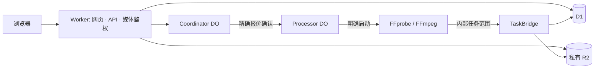

# 架构与数据行为 / Architecture and data behavior

[项目首页](../README.md) · [中文](#中文) · [English](#english) · [API](api.md) · [部署与恢复](deployment.md)

## 中文

### 组件与目录

一个环境使用一个 Worker，提供 React/Vite 静态资产、公开/管理员 API 和私有媒体分发；D1 保存目录、上传、版本、报价、任务、预留、历史、删除清单和统计。没有访客注册、外部数据库、常驻 Node 服务或公开 R2 桶要求。

| 位置 | 责任 |
| --- | --- |
| [`src/index.ts`](../src/index.ts)、[`src/http.ts`](../src/http.ts) | 路由、同源/鉴权边界、响应与定时维护 |
| [`src/auth.ts`](../src/auth.ts)、[`src/watch-access.ts`](../src/watch-access.ts) | 管理员会话、独立观看授权 |
| [`src/coordinator.ts`](../src/coordinator.ts)、[`src/uploads.ts`](../src/uploads.ts)、[`src/storage.ts`](../src/storage.ts) | 上传/容量与破坏性变更协调、精确删除 |
| [`src/source.ts`](../src/source.ts)、[`src/source-mp4.ts`](../src/source-mp4.ts)、[`src/fragmented-mp4.ts`](../src/fragmented-mp4.ts) | 原片身份、有界结构证明、MP4 范围响应 |
| [`src/billing.ts`](../src/billing.ts)、[`src/jobs.ts`](../src/jobs.ts)、[`src/processor.ts`](../src/processor.ts) | 报价/预算、任务范围、启动及停止监督 |
| [`src/resource-usage.ts`](../src/resource-usage.ts)、[`src/playback-analytics.ts`](../src/playback-analytics.ts)、[`src/history.ts`](../src/history.ts) | 独立资源用量、播放统计与观看进度 |
| [`web/`](../web/) | 欢迎页、放映室、后台与播放器 |
| [`container/`](../container/) | 固定依赖镜像、Node 处理器及 FFprobe/FFmpeg |
| [`migrations/`](../migrations/)、[`scripts/`](../scripts/) | 版本化 schema、初始化、Builds 与有保护的发布 |

Coordinator 序列化准入和破坏性修改。Processor 持久保存单任务启动尝试、截止时间、镜像、闹钟及停止证据。TaskBridge 与 Container 接口为内部绑定，公开路由不暴露代理/启动接口。

### 身份与访问边界

管理员密码及会话密钥缺失时拒绝管理访问。管理员会话 HMAC 绑定当前主机和密码状态，最长八小时；写操作要求精确当前 Origin。管理员、匿名历史、访客观看授权使用独立的 Secure/HttpOnly/host-only Cookie，不接受 URL Token，也不通过 IP 或设备指纹识别访客。

多域名共用目录和发布，Cookie 身份/历史按主机隔离。观看保护默认关闭；开启后在目录、历史及所有媒体请求进入缓存/R2 前验证。观看口令以随机盐 PBKDF2-SHA256（100000 次）摘要存于 D1；更改设置或撤销递增全局授权版本，旧 Cookie 不复活。配置异常拒绝授权，不降级公开。

### 上传、对象与结构证明

普通上传用 8 MiB 分片，20 GiB 硬上限，准入检查本项目实际桶/对象账本与并发预留，不查询全账户免费余额。客户端 `sha256-chunks-v1` 对全部分块及名称/大小/修改时间取聚合指纹，不是整文件单次 SHA-256；服务端独立验证每片实际长度和 SHA-256。

同时最多两个接收槽覆盖接收/排队缓冲/后续写入；接收不阻塞取消的串行队列，写前再次检查状态。分片限 30 秒空闲、五分钟总读取；JSON 限 10 秒空闲、30 秒总读取。等待超时不证明已发出的 R2 写入取消，不释放未知预留。到期清理在协调队列内复核 48 小时不活动期限，已续期上传不会被旧清理选择误删。

新原片键为 `videos/<videoId>/source/<sourceRevision>`；生成物为 `videos/<videoId>/versions/<versionId>/`。每次处理有独立版本，不覆盖原片或成功版本。原片播放版本只引用原对象，faststart 独立 MP4 与 HLS 拥有自己的对象。

原片检查绑定视频、对象键、revision、ETag、字节数及 parser 版本，最多读取 5 MiB 元数据、最多八个并发读，检查等待 90 秒。成功完整证明存于 `source_structural_checks`，跨 isolate 复用；缺失/陈旧/无效证明重验。每个 GET/HEAD/Range 仍鉴权并核对对象目录、完成上传和真实 R2 HEAD。证明不表示 FFprobe/完整解码、实播或发布，明确重验不回落旧证明。

支持的完整索引 fMP4 用浏览器 MSE 按需 Range 读取，仅在内存调整寻址，不改编码样本/时间戳/R2。初始化和尾索引各限 256 KiB、单片 16 MiB、保留编码片段 32 MiB。原生/MSE 能力和性能判断不证明实际硬件解码。更细的 MP4 约束见[API](api.md#中文)。

### 处理、发布与停止

报价不启动 Container。确认重新核对原片、账期、期限、包含量、空间和并发，原子创建任务/版本/预留；重复确认复用已创建任务。Container 用 `durable_object` 调度，实例与镜像受报价/部署固定，禁用公共互联网，仅通过内部任务范围桥接读取精确原片、写精确版本产物。没有账户、部署、管理员或 R2 凭据进入 Container。

无损 HLS/faststart 与转码分开授权；复杂轨道/附件/HDR/旋转/资源超限停止审阅。生成验证核对实际分页清单、大小、ETag/SHA-256、完整解码和模式对应时间轴/编码保留；不把服务器验证当作真实浏览器音画验收。

Processor 在启动前持久保存尝试和停止闹钟，页面关闭/Worker 重启后继续监督；未知启动交接不自动重启。停止核实要求 `running=false` 与 `inspect()=null`，未核实保留名额/预留。期限覆盖整个任务；工作负载提前 15 秒停止，所有者提前 10 秒进入销毁/核查，仍不承诺平台绝不会延迟。

发布显式选择已验证版本。服务端在进入共享队列前绑定 D1 发布 revision；下架直接递增 revision，旧排队发布即使稍后验证完成也不能复活。所有公开 GET/HEAD/Range/HLS 在缓存/R2 前验证当前公开版本；响应 no-store，已下载/缓冲不可回收。

### 历史、删除与持久统计

历史写入按主机/有效 Cookie 身份、时间轴、序号及实际播放增量校验。事件创建时捕获用途隔离的 HMAC `writeContext`；未知回执重试保留原事件编号/时间/上下文，Cookie 变化不能把旧事件写到新访客。超过五分钟或上下文失效需明确恢复，恢复先读取当前公开视频/历史和已接受 Cookie。清历史通知同源标签页，不传播访客标识；失败不自动中断媒体。

删除计划固定原片/版本依赖与精确对象身份，确认时重查活动任务、公开状态和范围；分批实际删除、核实缺失再同步目录，持久回执避免双算释放。部分失败可按原清单继续，不扩大范围。无自动清理原片/成功产物。Logo 替换/恢复默认保留旧对象。物理删除不退款、不自动恢复。

资源用量按固定窗口覆盖保存，滚动快照不相加，当前大小与累计计数分开；缺口不补零。播放统计是另外的签名访客上报链路，约 30 秒和生命周期边界发送有界累计快照，不按分片计播放。IP/UA 明细保留 30 天，长期每日汇总不含原始 IP/UA；上报失败不阻断播放。见[资源说明](resource-usage.md#中文)及[使用手册](user-guide.md#中文)。

### 品牌与搜索政策

`settings.site_branding_json` 保存名称、当前 Logo 与搜索开关；默认 `Video Hub`、内置图形、关闭收录。Logo 结构/尺寸和项目空间经验证，按内容 hash 不可变写入；未知写入保留预留。仅当前 Logo 可公开，替换不删除旧对象。

Worker 为 HTML 生成转义的标题/robots/OG 元数据及响应头，因此 `run_worker_first` 必须保留。缺失/异常设置默认 noindex，后台/API/错误永不索引；sitemap 仅列当前 origin 合格公开页面，观看保护仍独立执行。搜索指令是建议，不能删除搜索引擎已索引内容或替代鉴权。

## English

### Components and layout

Each environment owns one Worker serving React/Vite assets, public/admin APIs and private media. D1 holds catalog, upload parts, versions, quotes, jobs, reservations, history, deletion inventories and analytics. No visitor registration, external database, persistent Node server or public R2 bucket is required.

`src/index.ts`/`http.ts` own routes and request boundaries; `auth.ts`/`watch-access.ts` separate credentials; `coordinator.ts`/`uploads.ts`/`storage.ts` coordinate capacity and destructive operations; `source*.ts`/`fragmented-mp4.ts` validate source identities/structure; `billing.ts`/`jobs.ts`/`processor.ts` own quotes and supervised execution. `resource-usage.ts`, `playback-analytics.ts` and `history.ts` are separate data systems. `web/` contains the UI, `container/` the pinned processor image, `migrations/` the schema and `scripts/` bootstrap/Builds/guarded releases.

The diagram above shows Browser → Worker → D1/private R2/Coordinator → confirmed Processor → explicitly started FFprobe/FFmpeg. The internal TaskBridge gives exact-task media access. Coordinator serializes admission/destructive changes; Processor persists one task's attempt, image, deadline, alarms and stop evidence. Public routing exposes no Container proxy/start endpoint.

### Identity boundaries

Missing credentials deny management. HMAC administrator sessions bind host/password state and expire within eight hours; writes require exact Origin. Separate Secure/HttpOnly/host-only cookies serve administrators, anonymous history and viewing authorization, without URL tokens, IP identity or fingerprints. Connected domains share catalog/publication but isolate cookie/history identity.

Watching protection defaults off. When enabled, catalog/history/media are gated before cache/R2. D1 stores salted PBKDF2-SHA256 passphrase hashes with 100000 iterations. Setting changes/revocation advance a global generation; old cookies never revive. Broken configuration fails closed.

### Upload, objects and proofs

Uploads use 8 MiB parts and a 20 GiB limit, checking actual project inventory/ledger/concurrent reservations rather than account allowance. The client's `sha256-chunks-v1` aggregate covers all chunks and filename/size/modification time; it is not a single raw-file SHA-256. Server parts independently verify length/digest.

Two receive slots cover bodies, queued buffers and writes. Reception does not block serialized cancellation; mutation rechecks state. Parts have 30-second idle/five-minute total read limits and JSON ten-second idle/30-second total limits. Timeout does not cancel issued R2 operations or release unknown reservations. Expiry cleanup rechecks the 48-hour inactivity window inside the queue, protecting renewed uploads.

Sources use `videos/<videoId>/source/<sourceRevision>` and outputs `videos/<videoId>/versions/<versionId>/`. Processing never overwrites sources or successful versions. Source playback versions reference existing objects; faststart MP4/HLS versions own independent outputs.

Structure proofs bind video/key/revision/ETag/bytes/parser. Inspection has a 5 MiB total read cap, eight concurrent reads and 90-second metadata deadline. Complete compatible proofs persist across isolates; invalid/missing/obsolete proofs require fresh inspection. Every media request still checks authorization, index/completed upload and actual HEAD. Proofs are not FFprobe/full decode, browser evidence or publication; explicit failed rechecks do not fall back to old proofs.

Supported fully indexed fMP4 uses MSE ranges and in-memory addressing changes, preserving encoded samples/timestamps/R2. Initialization/index are each capped at 256 KiB, fragments 16 MiB and retained encoded fragments 32 MiB. Browser capability/performance predictions do not establish hardware decoding. See [API limits](api.md#english).

### Processing, publication and stopping

Quotes start no Container. Confirmation freshly checks identity, cycle/expiry, allowance, capacity/concurrency and atomically creates job/version/reservation. Replays reuse the existing task. Containers use `durable_object` scheduling, pinned deployed images and quoted instances, with public Internet disabled and only internal exact-source/output access. No account/deploy/admin/R2 credential enters the Container.

Lossless HLS/faststart and transcode have separate authorization. Complex streams/HDR/rotation/resources stop for review. Outputs validate actual paginated inventory, identity/checksum, full decode and mode-specific payload/timelines; this is not browser perceptual acceptance.

Attempts and stop alarms persist before start, surviving page closure/restart. Unknown handoffs never automatically restart. Verified stop needs `running=false` and `inspect()=null`; otherwise reservations/slots remain. The whole deadline includes every stage. Workload stops 15 seconds early and ownership shutdown begins ten seconds early, without promising no platform delay.

Publication explicitly chooses a verified version. Server-bound D1 revisions prevent queued earlier publication from reversing an unpublish: unpublish advances revision outside the shared queue. Public GET/HEAD/Range/HLS checks eligibility before cache/R2 with no-store responses. Delivered/buffered bytes cannot be recalled.

### History, deletion and analytics

History validates host/cookie identity, timeline, order and actual watching. Purpose-separated HMAC `writeContext` is captured when an event forms; retries retain ID/time/context and cannot migrate observations after cookie replacement. Five-minute/context failures need explicit recovery after current public video/history and cookie verification. Same-origin clear notifications disclose no visitor ID; saving failure does not itself stop media.

Deletion freezes exact identities/dependencies, rechecks tasks/publication/scope, physically deletes bounded batches, verifies absence and synchronizes indexes. Durable receipts prevent double-counting freed bytes. Partial work resumes without expanded scope; sources/successful outputs have no automatic cleanup. Logo replacement/reset preserves old objects. Deletion neither refunds bills nor restores files.

Resource windows overwrite measurements rather than adding rolling snapshots; gauges/counters stay separate and gaps stay unknown. Playback analytics use a separate signed visitor path with bounded cumulative events about every 30 seconds/lifecycle boundary, not per segment. Raw IP/UA details retain 30 days and independent daily aggregates persist without raw IP/UA. Reporting never blocks playback. See [usage](resource-usage.md#english) and [user behavior](user-guide.md#english).

### Branding and indexing

D1 `settings.site_branding_json` defaults to `Video Hub`, built-in Logo and indexing off. Validated images use immutable content hashes/project reservations; uncertain writes retain reservations. Only the current Logo is public, while replacements preserve old objects.

Worker-rendered escaped titles/robots/OG and headers require `run_worker_first`. Missing/broken settings produce noindex, and admin/API/errors remain excluded. Sitemap includes only current-origin eligible public pages; watching authorization is independent. Search directives are advisory, cannot erase existing results and do not replace access control.
